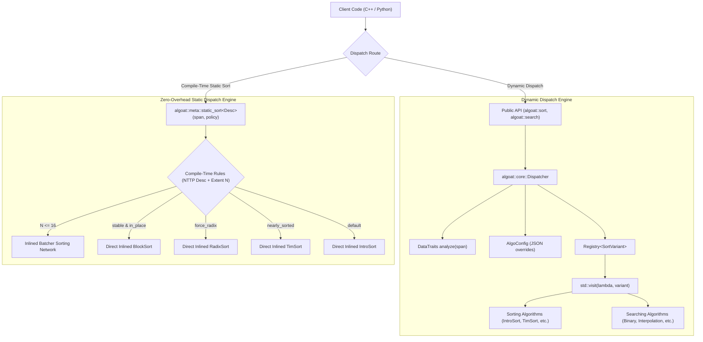
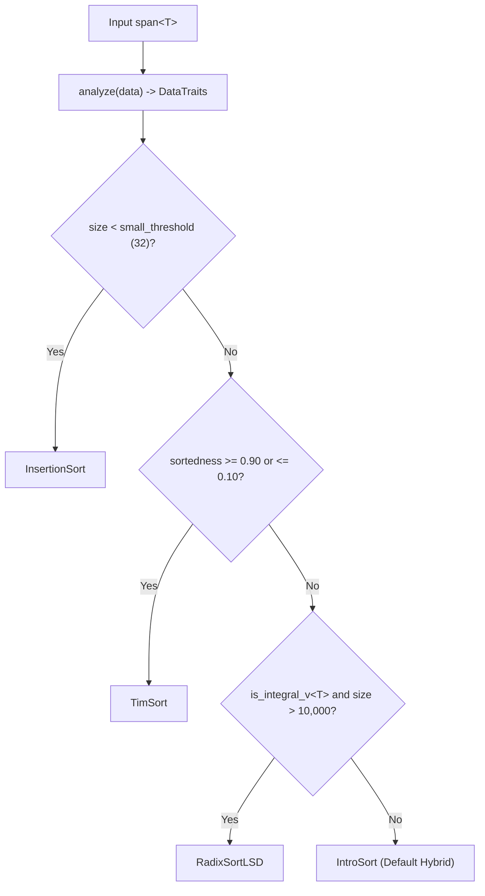

# Algoat: Architecture & Contributor Guide

Welcome to the internal architectural documentation for **Algoat**. This guide is designed to help developers and open-source contributors understand the internal design patterns, data flow, domain-specific algorithms, and contribution workflows of the library.

---

## 1. High-Level Architecture Overview

Algoat provides a **dual-dispatch paradigm** catering to both runtime and compile-time data invariants:
1. **Dynamic Heuristic Dispatch (`algoat::sort`, `algoat::search`)**: Built on a **Registry + Dispatcher** architecture that avoids virtual method table (`vtable`) overhead by leveraging C++20 concepts, `std::variant`, and `std::visit`.
2. **Zero-Overhead Static Dispatch (`algoat::meta::static_sort`)**: Complete compile-time resolution with $O(0)$ dispatch cycles, direct kernel inlining, and dead-code elimination (DCE) via ISO C++20 structural NTTP policies and declarative tag chains (`operator|`).



---

## 2. Core Engine Components

### 2.1 Data Profiling (`algoat::core::DataTraits`)
Located in [`include/algoat/core/traits.hpp`](include/algoat/core/traits.hpp).

Before dispatching to a sorting or searching algorithm, Algoat performs a single $O(N)$ pass over the input data using `algoat::core::analyze(data)`. This calculates:
- **`size`**: Number of elements.
- **`sortedness_ratio`**: Computed as $\frac{\text{count}(data[i-1] \le data[i])}{N - 1}$. A ratio of `1.0` means fully sorted in ascending order; `<= 0.10` indicates reverse-sorted data.
- **`has_duplicates`**: Boolean indicating whether any adjacent duplicate elements were detected.

### 2.2 Algorithm Registry (`algoat::core::Registry`)
Located in [`include/algoat/core/registry.hpp`](include/algoat/core/registry.hpp).

The `Registry<VariantType>` class stores string-to-factory mappings (`std::function<VariantType()>`).
- Avoids dynamic casting and class inheritance hierarchies.
- Enables string-based algorithm lookup with compile-time type safety.
- Instantiates algorithm structs stored directly in a `std::variant`.

### 2.3 Heuristic Dispatcher (`algoat::core::Dispatcher`)
Located in [`include/algoat/core/dispatcher.hpp`](include/algoat/core/dispatcher.hpp) and [`src/core/dispatcher.cpp`](src/core/dispatcher.cpp).

*Note: Domain-specific data types (e.g., `bool`, `std::complex`) that require highly specialized routing and cannot participate in dynamic profiling bypass the standard dynamic registry. These types are intentionally intercepted at compile-time via C++20 `if constexpr` concepts to avoid performance overhead.*

When `algoat::sort(span)` or `algoat::search(span, target)` is called with `"auto"` configuration (the default), the dispatcher executes this decision tree:



---

## 3. Compile-Time Algorithm Selector & Policy Chains

Located in [`include/algoat/meta/`](include/algoat/meta/).

When data properties (such as stability requirements, fixed buffer extent, or known distribution) are established at compile time, `algoat::meta::static_sort` completely bypasses runtime dynamic profiling, registry lookups, and branch table jumps.

### 3.1 C++20 Structural Class NTTP (`PolicyDescriptor`)
ISO C++20 §13.2 [temp.param]p7 allows classes with public, non-mutable data members and defaulted equality comparisons to serve as Non-Type Template Parameters:

```cpp
struct PolicyDescriptor {
    bool stable = false;
    bool in_place = true;
    bool nearly_sorted = false;
    bool force_radix = false;

    constexpr bool operator==(const PolicyDescriptor&) const = default;
};
```

Callers can pass descriptors directly as template arguments:
```cpp
algoat::meta::static_sort<PolicyDescriptor{.stable = true, .in_place = true}>(span);
```

### 3.2 Declarative Policy Tag Algebra (`PolicyChain`)
To provide intuitive, ergonomic syntax at call sites, Algoat defines declarative singleton tags composed via bitwise OR (`operator|`):
* `algoat::meta::policy::stable` vs `unstable` (`stability_facet`)
* `algoat::meta::policy::in_place` vs `out_of_place` (`memory_facet`)
* `algoat::meta::policy::nearly_sorted` (`order_facet`)
* `algoat::meta::policy::force_radix` (`kernel_facet`)

The resulting `PolicyChain<Tags...>` type validates policy invariants at compile-time:
* **Duplicate Tag Rejection**: Fold expressions detect duplicate occurrences (e.g. `p::stable | p::stable`).
* **Facet Conflict Rejection**: Conflicting tags (e.g. `p::stable | p::unstable`) trigger clean `static_assert` compiler diagnostics.
* **Semantic Constraints**: Conflicting constraints (e.g. `p::force_radix` requiring integral types) are enforced via concepts and `static_assert`.
* **Zero-Overhead Conversion**: `PolicyChain` implicitly and `constexpr` converts to `PolicyDescriptor` for static dispatch.

### 3.3 Compile-Time Algorithm Selection Hierarchy
`algoat::meta::static_sort(span, policy)` statically routes to the optimal algorithm using compile-time branching (`if constexpr`):

1. **$N \le 1$ Base Case**: Compile-time no-op.
2. **Fixed-Extent Small Arrays ($2 \le N \le 16$)**:
   * If non-stable and scalar/trivial: Inlines optimal Batcher odd-even sorting networks (`SortingNetworkTable<N>`) with branchless conditional swaps.
   * If stable: Inlines `algoat::sorting::insertionsort(span)`.
3. **Forced Radix (`force_radix == true`)**:
   * Statically asserts `std::is_integral_v<T> && !std::is_same_v<T, bool>`.
   * Inlines `algoat::sorting::radixsort_lsd(span)` (stable) or `radixsort_msd(span)` (unstable).
4. **Adaptive / Nearly Sorted (`nearly_sorted == true`)**:
   * Dispatches to `algoat::sorting::timsort(span)`.
5. **Stable Sort (`stable == true`)**:
   * If `in_place`: Inlines `algoat::sorting::blocksort(span)` (O(1) memory).
   * If `out_of_place`: Inlines `algoat::sorting::mergesort(span)` (O(N) memory).
6. **General Unstable Default**:
   * If fixed extent $N \le 32$: Inlines `algoat::sorting::insertionsort(span)`.
   * Otherwise: Inlines `algoat::sorting::introsort(span)`.

---

## 4. Domain-Specific Numerics & Hardware Acceleration

Located in [`include/algoat/numerics/`](include/algoat/numerics/) and [`include/algoat/searching/`](include/algoat/searching/).

### 4.1 Float16 Bit-Flip Sort (`float16_sort.hpp`)
Standard floating-point comparisons involve costly floating-point comparison instructions and branch mispredictions. Algoat transforms IEEE-754 16-bit floating-point values into order-preserving unsigned integers:
- **Negative floats** (`u & 0x8000 != 0`): Invert all bits (`~u`).
- **Positive floats** (`u & 0x8000 == 0`): Set sign bit (`u | 0x8000`).

This maps floating point numbers from $- \infty \dots +\infty$ into a strictly monotonic unsigned domain $[0\text{x}0000 \dots 0\text{xFFFF}]$. Large arrays ($\ge 65,536$ elements) are then sorted in a single $O(N)$ counting pass with $65,536$ buckets.

### 4.2 Complex Number Morton Z-Order Sort (`morton.hpp`)
Rather than sorting complex numbers along a single 1D axis (lexicographically by real then imaginary part), Algoat sorts complex numbers along the **2D Morton Z-Order Space-Filling Curve**.
- Interleaves bits of the 32-bit real coordinate with the 32-bit imaginary coordinate into a single 64-bit spatial key.
- Uses x86-64 BMI2 hardware acceleration (`_pdep_u64`) when available.
- Sorts 64-bit Morton keys with an ultra-fast 4-pass 16-bit Radix Sort.
- Preserves 2D spatial locality in cache for spatial indexing and nearest-neighbor applications.

### 4.3 Cache-Oblivious Eytzinger Search Engine (`eytzinger_search_tree.hpp`)
Located in [`include/algoat/searching/eytzinger_search_tree.hpp`](include/algoat/searching/eytzinger_search_tree.hpp).
- Rearranges sorted elements into a 1-indexed breadth-first complete binary search tree layout (Eytzinger array layout).
- Top tree levels reside contiguously in L1 cache lines, eliminating pointer indirection.
- Incorporates deterministic software lookahead prefetching (`__builtin_prefetch` / `_mm_prefetch`) to overlap DRAM memory access latency with branchless index calculations.
- Yields a **2x to 3x query speedup** over `std::lower_bound` for cache-sized datasets.

---

## 5. How to Add a New Sorting Algorithm

To contribute a new sorting algorithm to Algoat, follow these 4 steps *(unless it is a domain-specific static dispatch optimization for a single type, in which case it is intercepted via `if constexpr` in `Dispatcher::sort` directly)*:

### Step 1: Implement the Header
Create `include/algoat/sorting/my_new_sort.hpp`. Expose idiomatic C++20 range free function templates supporting comparators and projections, span convenience overloads, a lightweight adapter struct satisfying `algoat::sorting::SortAlgorithm`, and invoke the automated registry macro:

```cpp
#pragma once

#include "algoat/core/traits.hpp" // for make_comp_proj
#include <concepts>
#include <functional>
#include <iterator>
#include <ranges>
#include <span>
#include <string_view>
#include <utility>

namespace algoat::sorting {

// 1. Idiomatic C++20 Ranges Free Function with Comparator & Projection Support
template <std::ranges::random_access_range R,
          typename Comp = std::ranges::less,
          typename Proj = std::identity>
    requires std::sortable<std::ranges::iterator_t<R>, Comp, Proj>
constexpr std::ranges::borrowed_iterator_t<R> my_new_sort(R&& data, Comp comp = {},
                                                            Proj proj = {}) {
    auto comp_proj = ::algoat::detail::make_comp_proj(comp, proj);
    // Core sorting implementation using comp_proj...
    return std::ranges::next(std::ranges::begin(data), std::ranges::end(data));
}

// 2. Span Convenience Overloads
template <typename T, typename Compare>
constexpr void my_new_sort(std::span<T> data, Compare comp) {
    my_new_sort(data, std::move(comp), std::identity{});
}

template <typename T>
constexpr void my_new_sort(std::span<T> data) {
    my_new_sort(data, std::ranges::less{});
}

// 3. Zero-Overhead Adapter Struct Satisfying SortAlgorithm Concept
struct MyNewSort {
    [[nodiscard]] constexpr std::string_view name() const noexcept {
        return "mynewsort";
    }

    [[nodiscard]] constexpr std::size_t preferred_min_size() const noexcept {
        return 0; // Minimum element count where this algorithm is preferred
    }

    template <typename T>
    void sort(std::span<T> data) const {
        my_new_sort(data);
    }

    template <typename T, typename Compare>
    void sort(std::span<T> data, Compare comp) const {
        my_new_sort(data, std::move(comp));
    }
};

} // namespace algoat::sorting

// 4. Automated Registration into Global Algorithm Registry
#include "algoat/core/registry.hpp"

ALGOAT_REGISTER_ALGORITHM("sorting", "mynewsort", ::algoat::sorting::MyNewSort)
```

### Step 2: Register in `SortVariant`
In [`include/algoat/sorting/sorting.hpp`](include/algoat/sorting/sorting.hpp):
1. `#include "algoat/sorting/my_new_sort.hpp"`
2. Add `MyNewSort` to the `SortVariant` type alias:
   ```cpp
   using SortVariant =
       std::variant<InsertionSort, QuickSort, ..., MyNewSort>;
   ```

> [!NOTE]
> `Registry<SortVariant>` leverages `VariantCaster<SortVariant>` to safely unpack algorithm instances held in the type-erased `BaseRegistry` into the concrete `std::variant` at runtime with zero virtual method dispatch overhead.

### Step 3: Automated Static Registry (No Dispatcher Edits Needed)
In modern Algoat, algorithm registration is **fully decentralized**:
- The `ALGOAT_REGISTER_ALGORITHM("sorting", "mynewsort", ::algoat::sorting::MyNewSort)` macro automatically registers the factory function into `::algoat::core::BaseRegistry::global("sorting")` during static initialization before `main()` executes.
- `Dispatcher` automatically binds to `Registry<sorting::SortVariant>::global("sorting")` on initialization.
- **You do not need to edit `src/core/dispatcher.cpp`**.

### Step 4: Add Unit Tests, PBT, and Fuzzing
Add verification across all test harnesses:

1. **Unit Tests** in [`tests/sorting/test_my_new_sort.cpp`](tests/sorting/):
   ```cpp
   #include <gtest/gtest.h>
   #include "algoat/sorting/my_new_sort.hpp"
   #include <vector>

   TEST(MyNewSortTest, RangesAndProjections) {
       struct Item { int value; };
       std::vector<Item> data = {{5}, {1}, {3}};
       algoat::sorting::my_new_sort(data, std::ranges::less{}, &Item::value);
       EXPECT_EQ(data[0].value, 1);
       EXPECT_EQ(data[1].value, 3);
       EXPECT_EQ(data[2].value, 5);
   }

   TEST(MyNewSortTest, AdapterSortsSpan) {
       std::vector<int> data = {9, 3, 1, 5, 2};
       algoat::sorting::MyNewSort{}.sort(std::span{data});
       EXPECT_TRUE(std::is_sorted(data.begin(), data.end()));
   }
   ```

2. **Property-Based Testing (PBT)** in [`tests/pbt/test_sorting_invariants.cpp`](tests/pbt/test_sorting_invariants.cpp):
   Add `MyNewSort` to `ComparativeSortAlgos` (and `StableSortAlgos` if the algorithm is stable). RapidCheck will automatically test conservation, monotonic sortedness, and idempotency invariants across thousands of pseudo-random inputs:
   ```cpp
   using ComparativeSortAlgos =
       ::testing::Types<SelectionSort, BubbleSort, ..., MyNewSort>;
   ```

3. **Differential Fuzzing** in [`tests/fuzzing/diff_sort_fuzzer.cpp`](tests/fuzzing/diff_sort_fuzzer.cpp):
   Add `MyNewSort` to the LLVM libFuzzer test harness to continuously verify identical ordering against `std::sort` / `std::stable_sort` over raw mutated byte streams.

---

## 6. Python nanobind Interoperability

Located in [`python/`](python/).

- **Zero-Copy NumPy Views**: NumPy arrays are converted to C-contiguous `nb::ndarray` views and mapped directly to `std::span<T>`, executing pure C++ code without memory allocations.
- **GIL Management**: Python list sorting unboxes elements into C++ wrappers (`PyFloatWrapper`, `PyBigIntWrapper`, `PyStringWrapper`), releases the Python GIL (`nb::gil_scoped_release`), sorts using C++ algorithms, and reconstructs the Python list.
- **Rich Comparisons**: `PyGenericWrapper` uses `PyObject_RichCompareBool` with thread-safe GIL acquisition for arbitrary custom Python objects.

---

## 7. Build, Test, and Benchmark Workflows

### Building the C++ Library & Tests
```bash
# Configure with CMake Presets
cmake --preset debug
cmake --build --preset debug -j$(nproc)

# Run full GoogleTest + RapidCheck suite (494 tests)
ctest --preset debug --output-on-failure

# Memory safety validation via AddressSanitizer and UndefinedBehaviorSanitizer
cmake --preset asan
cmake --build --preset asan -j$(nproc)
ctest --test-dir build/asan --output-on-failure
```

### Building & Testing Python Bindings
```bash
# Rebuild and install editable nanobind C++ extension into active virtual environment
CXX=g++ CC=gcc pip install --no-build-isolation -e .

# Run pytest suite
pytest tests/python/
```

### Running Benchmarks
```bash
# Build release benchmarks
cmake --preset release
cmake --build --preset release -j$(nproc)

# C++ sorting and search benchmarks
./build/release/benchmarks/bench_sorting
./build/release/benchmarks/bench_eytzinger_search

# Python / NumPy speedup benchmarks
python benchmarks/bench_python.py
python examples/python/benchmark.py
```
