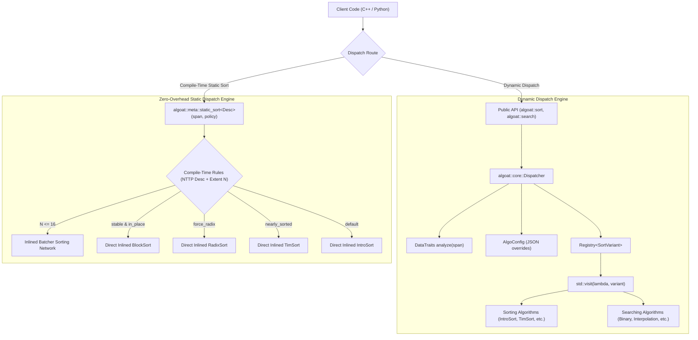
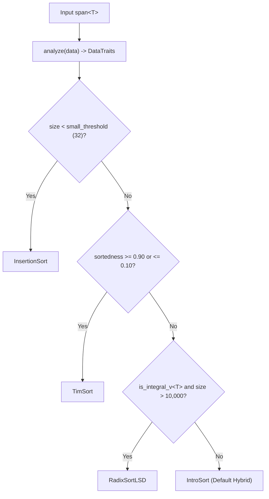
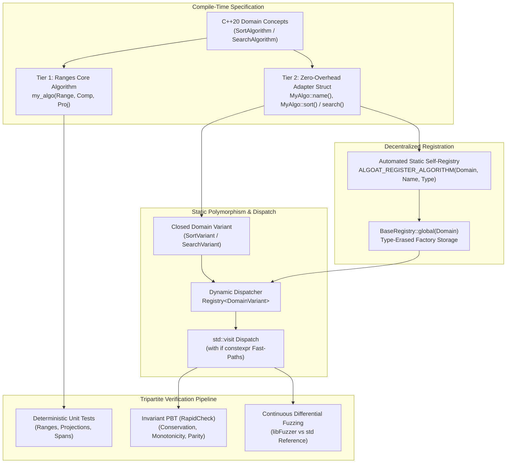

# Algoat: Architecture & Contributor Guide

Welcome to the internal architectural documentation for **Algoat**. This guide is designed to help developers and open-source contributors understand the internal design patterns, data flow, domain-specific algorithms, and contribution workflows of the library.

---

## 1. High-Level Architecture Overview

Algoat provides a **dual-dispatch paradigm** catering to both runtime and compile-time data invariants:
1. **Dynamic Heuristic Dispatch (`algoat::sort`, `algoat::search`)**: Built on a **Registry + Dispatcher** architecture that avoids virtual method table (`vtable`) overhead by leveraging C++20 concepts, `std::variant`, and `std::visit`.
2. **Zero-Overhead Static Dispatch (`algoat::meta::static_sort`)**: Complete compile-time resolution with $O(0)$ dispatch cycles, direct kernel inlining, and dead-code elimination (DCE) via ISO C++20 structural NTTP policies and declarative tag chains (`operator|`).



---

## 2. Core Engine Components

### 2.1 Data Profiling (`algoat::core::DataTraits`)
Located in [`include/algoat/core/traits.hpp`](include/algoat/core/traits.hpp).

Before dispatching to a sorting or searching algorithm, Algoat performs a single $O(N)$ pass over the input data using `algoat::core::analyze(data)`. This calculates:
- **`size`**: Number of elements.
- **`sortedness_ratio`**: Computed as $\frac{\text{count}(data[i-1] \le data[i])}{N - 1}$. A ratio of `1.0` means fully sorted in ascending order; `<= 0.10` indicates reverse-sorted data.
- **`has_duplicates`**: Boolean indicating whether any adjacent duplicate elements were detected.

### 2.2 Algorithm Registry (`algoat::core::Registry`)
Located in [`include/algoat/core/registry.hpp`](include/algoat/core/registry.hpp).

The `Registry<VariantType>` class stores string-to-factory mappings (`std::function<VariantType()>`).
- Avoids dynamic casting and class inheritance hierarchies.
- Enables string-based algorithm lookup with compile-time type safety.
- Instantiates algorithm structs stored directly in a `std::variant`.

### 2.3 Heuristic Dispatcher (`algoat::core::Dispatcher`)
Located in [`include/algoat/core/dispatcher.hpp`](include/algoat/core/dispatcher.hpp) and [`src/core/dispatcher.cpp`](src/core/dispatcher.cpp).

*Note: Domain-specific data types (e.g., `bool`, `std::complex`) that require highly specialized routing and cannot participate in dynamic profiling bypass the standard dynamic registry. These types are intentionally intercepted at compile-time via C++20 `if constexpr` concepts to avoid performance overhead.*

When `algoat::sort(span)` or `algoat::search(span, target)` is called with `"auto"` configuration (the default), the dispatcher executes this decision tree:



---

## 3. Compile-Time Algorithm Selector & Policy Chains

Located in [`include/algoat/meta/`](include/algoat/meta/).

When data properties (such as stability requirements, fixed buffer extent, or known distribution) are established at compile time, `algoat::meta::static_sort` completely bypasses runtime dynamic profiling, registry lookups, and branch table jumps.

### 3.1 C++20 Structural Class NTTP (`PolicyDescriptor`)
ISO C++20 §13.2 [temp.param]p7 allows classes with public, non-mutable data members and defaulted equality comparisons to serve as Non-Type Template Parameters:

```cpp
struct PolicyDescriptor {
    bool stable = false;
    bool in_place = true;
    bool nearly_sorted = false;
    bool force_radix = false;

    constexpr bool operator==(const PolicyDescriptor&) const = default;
};
```

Callers can pass descriptors directly as template arguments:
```cpp
algoat::meta::static_sort<PolicyDescriptor{.stable = true, .in_place = true}>(span);
```

### 3.2 Declarative Policy Tag Algebra (`PolicyChain`)
To provide intuitive, ergonomic syntax at call sites, Algoat defines declarative singleton tags composed via bitwise OR (`operator|`):
* `algoat::meta::policy::stable` vs `unstable` (`stability_facet`)
* `algoat::meta::policy::in_place` vs `out_of_place` (`memory_facet`)
* `algoat::meta::policy::nearly_sorted` (`order_facet`)
* `algoat::meta::policy::force_radix` (`kernel_facet`)

The resulting `PolicyChain<Tags...>` type validates policy invariants at compile-time:
* **Duplicate Tag Rejection**: Fold expressions detect duplicate occurrences (e.g. `p::stable | p::stable`).
* **Facet Conflict Rejection**: Conflicting tags (e.g. `p::stable | p::unstable`) trigger clean `static_assert` compiler diagnostics.
* **Semantic Constraints**: Conflicting constraints (e.g. `p::force_radix` requiring integral types) are enforced via concepts and `static_assert`.
* **Zero-Overhead Conversion**: `PolicyChain` implicitly and `constexpr` converts to `PolicyDescriptor` for static dispatch.

### 3.3 Compile-Time Algorithm Selection Hierarchy
`algoat::meta::static_sort(span, policy)` statically routes to the optimal algorithm using compile-time branching (`if constexpr`):

1. **$N \le 1$ Base Case**: Compile-time no-op.
2. **Fixed-Extent Small Arrays ($2 \le N \le 16$)**:
   * If non-stable and scalar/trivial: Inlines optimal Batcher odd-even sorting networks (`SortingNetworkTable<N>`) with branchless conditional swaps.
   * If stable: Inlines `algoat::sorting::insertionsort(span)`.
3. **Forced Radix (`force_radix == true`)**:
   * Statically asserts `std::is_integral_v<T> && !std::is_same_v<T, bool>`.
   * Inlines `algoat::sorting::radixsort_lsd(span)` (stable) or `radixsort_msd(span)` (unstable).
4. **Adaptive / Nearly Sorted (`nearly_sorted == true`)**:
   * Dispatches to `algoat::sorting::timsort(span)`.
5. **Stable Sort (`stable == true`)**:
   * If `in_place`: Inlines `algoat::sorting::blocksort(span)` (O(1) memory).
   * If `out_of_place`: Inlines `algoat::sorting::mergesort(span)` (O(N) memory).
6. **General Unstable Default**:
   * If fixed extent $N \le 32$: Inlines `algoat::sorting::insertionsort(span)`.
   * Otherwise: Inlines `algoat::sorting::introsort(span)`.

---

## 4. Domain-Specific Numerics & Hardware Acceleration

Located in [`include/algoat/numerics/`](include/algoat/numerics/) and [`include/algoat/searching/`](include/algoat/searching/).

### 4.1 Float16 Bit-Flip Sort (`float16_sort.hpp`)
Standard floating-point comparisons involve costly floating-point comparison instructions and branch mispredictions. Algoat transforms IEEE-754 16-bit floating-point values into order-preserving unsigned integers:
- **Negative floats** (`u & 0x8000 != 0`): Invert all bits (`~u`).
- **Positive floats** (`u & 0x8000 == 0`): Set sign bit (`u | 0x8000`).

This maps floating point numbers from $- \infty \dots +\infty$ into a strictly monotonic unsigned domain $[0\text{x}0000 \dots 0\text{xFFFF}]$. Large arrays ($\ge 65,536$ elements) are then sorted in a single $O(N)$ counting pass with $65,536$ buckets.

### 4.2 Complex Number Morton Z-Order Sort (`morton.hpp`)
Rather than sorting complex numbers along a single 1D axis (lexicographically by real then imaginary part), Algoat sorts complex numbers along the **2D Morton Z-Order Space-Filling Curve**.
- Interleaves bits of the 32-bit real coordinate with the 32-bit imaginary coordinate into a single 64-bit spatial key.
- Uses x86-64 BMI2 hardware acceleration (`_pdep_u64`) when available.
- Sorts 64-bit Morton keys with an ultra-fast 4-pass 16-bit Radix Sort.
- Preserves 2D spatial locality in cache for spatial indexing and nearest-neighbor applications.

### 4.3 Cache-Oblivious Eytzinger Search Engine (`eytzinger_search_tree.hpp`)
Located in [`include/algoat/searching/eytzinger_search_tree.hpp`](include/algoat/searching/eytzinger_search_tree.hpp).
- Rearranges sorted elements into a 1-indexed breadth-first complete binary search tree layout (Eytzinger array layout).
- Top tree levels reside contiguously in L1 cache lines, eliminating pointer indirection.
- Incorporates deterministic software lookahead prefetching (`__builtin_prefetch` / `_mm_prefetch`) to overlap DRAM memory access latency with branchless index calculations.
- Yields a **2x to 3x query speedup** over `std::lower_bound` for cache-sized datasets.

### 4.4 HyperLogLog++ Cardinality Estimation Sketch (`hyperloglog.hpp`)
Located in [`include/algoat/sketches/`](include/algoat/sketches/).
- Implements Google's HyperLogLog++ algorithm (Heule et al. 2013) with uniform 64-bit hashing, pushing hash collision barriers beyond $10^{18}$ cardinalities.
- **Dual Representation**: Starts in high-precision sparse mode ($p' = 25$, $m' = 2^{25}$ virtual registers) using sorted difference representations, achieving $0.018\%$ relative standard error for small sets, before automatically promoting to dense mode ($P \in [4, 18]$) when memory footprint reaches $6m$ bits.
- **AVX2 Vectorization**: Accelerated harmonic sum calculation using double-precision SIMD bit-shifts (`(1023 - k) << 52`), avoiding single-precision float32 absorption errors across up to 262,144 registers. In-place merge processes dense registers at over 50 GB/s using 4-way unrolled `_mm256_max_epu8`.
- **6-NN Empirical Bias Correction**: Interpolates empirical bias correction tables across $P \in [4, 18]$ in the transition range between Linear Counting and asymptotic Flajolet estimation ($E \le 5m$).
- **Redis Wire Compatibility**: Serializes into Redis-compatible 16-byte `struct hllhdr` headers with dense 6-bit packed registers when $P = 14$ (12,304 bytes total).

### 4.5 Count-Min Sketch with Conservative Update & Space-Saving Heavy Hitters (`count_min.hpp`)
Located in [`include/algoat/sketches/`](include/algoat/sketches/).
- **Count-Min Sketch (`CountMinSketch`)**: Implements Cormode & Muthukrishnan (2005) with Estan & Varghese (2002) Conservative Update (CU). Slashes false positive overestimation error by $50\%\text{--}70\%$ under Zipfian skew while strictly preserving the one-sided non-underestimation invariant ($\hat{f}(x) \ge f(x)$).
- **Column-Interleaved Counter Matrix & Cache Locality**: Counters are laid out in column-interleaved order (`col * depth_ + j`) so that the $d$ row counters $[C[0, \text{col}], C[1, \text{col}], \dots, C[d-1, \text{col}]]$ corresponding to a shared column coordinate reside contiguously in 64-byte cache lines.
- **Fast Independent Hashing & AVX2 Acceleration**: Computes row indices using Dietzfelbinger multiply-shift with precomputed `ROW_M1` and `ROW_M2` tables and Lemire's FastRange (`(hash32 * width) >> 32`), vectorized under AVX2 using `_mm256_mul_epu32` and `_mm256_srli_epi64`. Vectorized horizontal minimum reduction is evaluated in parallel using `_mm256_min_epu32` and `_mm_min_epu32`.
- **Saturating Merge**: Combines sketch instances of identical dimensions with AVX2 saturating 32-bit unsigned arithmetic (`_mm256_add_epi32` clamped against bitwise inverted accumulator).
- **Space-Saving Top-$k$ Engine (`SpaceSavingHeavyHitters` / `SpaceSaving`)**: Constant-space Metwally et al. (2005) `Stream-Summary` engine maintaining a contiguous doubly-linked frequency bucket pool with $O(1)$ fast-path tail insertion and an open-addressed power-of-two flat hash table with cyclic backward-shift deletion. Provides $O(1)$ stream ingestion with zero heap allocations during stream updates, recovering heavy hitters with guaranteed error bounds ($\hat{f}(x) - \text{error}(x) \le f(x) \le \hat{f}(x)$ and $\sum_{i=1}^K \hat{f}_i = N$).

---

## 5. Adding New Algorithms: Extensible Domain Architecture Guide

Algoat structures its algorithmic portfolio across distinct domains (`"sorting"`, `"searching"`). Rather than using intrusive monolithic dispatch tables or traditional object-oriented virtual inheritance, every domain follows a uniform, decentralized lifecycle built on compile-time C++20 concepts, static polymorphism via closed variants (`std::variant`), and automatic static registry binding.



---

### 5.1 Domain Concept Contracts

Every algorithm in Algoat must satisfy the compile-time contract defined in its domain umbrella header:

#### Sorting Domain (`include/algoat/sorting/sorting.hpp`)
```cpp
template <typename Algo, typename T>
concept SortAlgorithm = requires(Algo algo, std::span<T> data) {
    { algo.name() } -> std::convertible_to<std::string_view>;
    { algo.sort(data) } -> std::same_as<void>;
    { algo.preferred_min_size() } -> std::convertible_to<std::size_t>;
};
```

#### Searching Domain (`include/algoat/searching/searching.hpp`)
```cpp
template <typename Algo, typename T>
concept SearchAlgorithm = requires(Algo algo, std::span<T> data, const T& target) {
    { algo.name() } -> std::convertible_to<std::string_view>;
    { algo.search(data, target) } -> std::same_as<std::optional<std::size_t>>;
    { algo.requires_sorted() } -> std::same_as<bool>;
};
```

---

### 5.2 Step-by-Step Implementation Workflow

Adding an algorithm to any domain follows four standardized steps:

#### Step 1: Implement the Header and Adapter
Create the header under `include/algoat/<domain>/my_new_<algo>.hpp`. Expose:
1. **Tier 1 (Direct C++20 Ranges Interface)**: A range-based algorithm constrained with standard concepts (`std::ranges::random_access_range`, `std::sortable`, or `std::indirect_strict_weak_order`), supporting projection forwarding via `::algoat::detail::make_comp_proj`.
2. **Tier 2 (Span Convenience Overloads & Adapter Struct)**: An adapter struct conforming to the domain concept (`SortAlgorithm` or `SearchAlgorithm`).
3. **Automated Static Registration**: Call `ALGOAT_REGISTER_ALGORITHM(Domain, Name, Type)` at file scope to register the constructor with `BaseRegistry::global(Domain)`.

##### Example A: Sorting Domain (`include/algoat/sorting/my_new_sort.hpp`)
```cpp
#pragma once

#include "algoat/core/traits.hpp" // for make_comp_proj
#include <concepts>
#include <functional>
#include <iterator>
#include <ranges>
#include <span>
#include <string_view>
#include <utility>

namespace algoat::sorting {

// Tier 1: C++20 Ranges Free Function with Comparator and Projection
template <std::ranges::random_access_range R,
          typename Comp = std::ranges::less,
          typename Proj = std::identity>
    requires std::sortable<std::ranges::iterator_t<R>, Comp, Proj>
constexpr std::ranges::borrowed_iterator_t<R> my_new_sort(R&& data, Comp comp = {},
                                                            Proj proj = {}) {
    auto comp_proj = ::algoat::detail::make_comp_proj(comp, proj);
    // Algorithm core using comp_proj...
    return std::ranges::next(std::ranges::begin(data), std::ranges::end(data));
}

// Span Overloads
template <typename T, typename Compare>
constexpr void my_new_sort(std::span<T> data, Compare comp) {
    my_new_sort(data, std::move(comp), std::identity{});
}

template <typename T>
constexpr void my_new_sort(std::span<T> data) {
    my_new_sort(data, std::ranges::less{});
}

// Tier 2: Zero-Overhead Adapter Conforming to SortAlgorithm
struct MyNewSort {
    [[nodiscard]] constexpr std::string_view name() const noexcept {
        return "mynewsort";
    }

    [[nodiscard]] constexpr std::size_t preferred_min_size() const noexcept {
        return 0; // Minimum element threshold where algorithm is optimal
    }

    template <typename T>
    void sort(std::span<T> data) const {
        my_new_sort(data);
    }

    template <typename T, typename Compare>
    void sort(std::span<T> data, Compare comp) const {
        my_new_sort(data, std::move(comp));
    }
};

} // namespace algoat::sorting

// Automated Self-Registration
#include "algoat/core/registry.hpp"

ALGOAT_REGISTER_ALGORITHM("sorting", "mynewsort", ::algoat::sorting::MyNewSort)
```

##### Example B: Searching Domain (`include/algoat/searching/my_new_search.hpp`)
```cpp
#pragma once

#include <concepts>
#include <cstddef>
#include <functional>
#include <optional>
#include <ranges>
#include <span>
#include <string_view>

namespace algoat::searching {

// Tier 1: C++20 Ranges Free Function
template <std::ranges::random_access_range R, typename T = std::ranges::range_value_t<R>,
          typename Comp = std::ranges::less, typename Proj = std::identity>
    requires std::indirect_strict_weak_order<Comp, const T*,
                                             std::projected<std::ranges::iterator_t<R>, Proj>>
std::optional<std::size_t> my_new_search(R&& data, const T& target, Comp comp = {},
                                         Proj proj = {}) {
    // Algorithm core using comparator and projection...
    return std::nullopt;
}

// Span Overloads
template <typename T>
std::optional<std::size_t> my_new_search(std::span<const T> data, const T& target) {
    return my_new_search(data, target, std::ranges::less{}, std::identity{});
}

// Tier 2: Zero-Overhead Adapter Conforming to SearchAlgorithm
struct MyNewSearch {
    [[nodiscard]] constexpr std::string_view name() const noexcept {
        return "mynewsearch";
    }

    [[nodiscard]] constexpr bool requires_sorted() const noexcept {
        return true; // true if algorithm requires pre-sorted input sequence
    }

    template <typename T>
    std::optional<std::size_t> search(std::span<const T> data, const T& target) const {
        return my_new_search(data, target);
    }
};

} // namespace algoat::searching

// Automated Self-Registration
#include "algoat/core/registry.hpp"

ALGOAT_REGISTER_ALGORITHM("searching", "mynewsearch", ::algoat::searching::MyNewSearch)
```

---

#### Step 2: Register in the Domain Variant

In the domain umbrella header ([`include/algoat/sorting/sorting.hpp`](include/algoat/sorting/sorting.hpp) or [`include/algoat/searching/searching.hpp`](include/algoat/searching/searching.hpp)):
1. `#include "algoat/<domain>/my_new_<algo>.hpp"`
2. Append the adapter type to the domain `std::variant`:

```cpp
// For Sorting:
using SortVariant = std::variant<InsertionSort, QuickSort, ..., MyNewSort>;

// For Searching:
using SearchVariant = std::variant<LinearSearch, BinarySearch, ..., MyNewSearch>;
```

> [!NOTE]
> **Static Polymorphism Rationale**: Algoat avoids dynamic dispatch through virtual method tables. Instead, `Registry<DomainVariant>` maps `std::any` instances from the global registry into the variant via `VariantCaster`. Dispatch executes at runtime using `std::visit`, allowing the compiler to optimize and inline algorithm invocations without pointer indirection or cache pollution.

---

#### Step 3: Dispatcher Integration & Specialization Interception

1. **Dynamic Heuristic Dispatch**: Standard algorithms require **no edits** to [`src/core/dispatcher.cpp`](src/core/dispatcher.cpp). The `Dispatcher` dynamically queries `Registry<DomainVariant>::global(Domain)` using runtime input traits (size, sortedness ratio, element type).
2. **Compile-Time Hardware / Numeric Interception**: For domain-specific hardware or numeric specializations (e.g., `bool` via `sort_boolean`, `std::complex` via `sort_complex_morton`, or cache-oblivious `EytzingerSearchTree`), add an explicit `if constexpr` branch inside `Dispatcher::sort` or `Dispatcher::search`:
   ```cpp
   if constexpr (IsSpecialType<ElementType> && std::is_same_v<Comp, std::ranges::less>) {
       my_specialized_kernel(span_view);
       return std::ranges::next(std::ranges::begin(data), std::ranges::end(data));
   }
   ```

---

#### Step 4: Tripartite Verification Suite

Every algorithm must pass three distinct verification tiers before merging:

1. **Deterministic Unit Tests** ([`tests/sorting/`](tests/sorting/) or [`tests/searching/`](tests/searching/)):
   Validate range projections, span overloads, custom comparators, empty/single-element boundary cases, and adapter struct compliance.

2. **Property-Based Invariant Testing (PBT)**:
   Add the adapter type to the parameterized test suite in [`tests/pbt/test_sorting_invariants.cpp`](tests/pbt/test_sorting_invariants.cpp) or [`tests/pbt/test_searching_invariants.cpp`](tests/pbt/test_searching_invariants.cpp):
   ```cpp
   // Sorting invariants: conservation, monotonic ordering, idempotency
   using ComparativeSortAlgos = ::testing::Types<..., MyNewSort>;
   TYPED_TEST_SUITE(ComparativeSortPBT, ComparativeSortAlgos);

   // Searching invariants: positive match parity, absence guarantee, sorted precondition
   using SearchAlgos = ::testing::Types<..., MyNewSearch>;
   TYPED_TEST_SUITE(SearchingPBT, SearchAlgos);
   ```

3. **Continuous Differential Fuzzing**:
   Add the algorithm to [`tests/fuzzing/diff_sort_fuzzer.cpp`](tests/fuzzing/diff_sort_fuzzer.cpp) or [`tests/fuzzing/diff_search_fuzzer.cpp`](tests/fuzzing/diff_search_fuzzer.cpp) to verify bit-level output parity against `std::sort`, `std::stable_sort`, `std::find`, or `std::lower_bound` over raw mutated byte buffers under LLVM libFuzzer.

---

## 6. Python nanobind Interoperability

Located in [`python/`](python/).

- **Zero-Copy NumPy Views**: NumPy arrays are converted to C-contiguous `nb::ndarray` views and mapped directly to `std::span<T>`, executing pure C++ code without memory allocations.
- **GIL Management**: Python list sorting unboxes elements into C++ wrappers (`PyFloatWrapper`, `PyBigIntWrapper`, `PyStringWrapper`), releases the Python GIL (`nb::gil_scoped_release`), sorts using C++ algorithms, and reconstructs the Python list.
- **Rich Comparisons**: `PyGenericWrapper` uses `PyObject_RichCompareBool` with thread-safe GIL acquisition for arbitrary custom Python objects.

---

## 7. Build, Test, and Benchmark Workflows

### Building the C++ Library & Tests
```bash
# Configure with CMake Presets
cmake --preset debug
cmake --build --preset debug -j$(nproc)

# Run full GoogleTest + RapidCheck suite (494 tests)
ctest --preset debug --output-on-failure

# Memory safety validation via AddressSanitizer and UndefinedBehaviorSanitizer
cmake --preset asan
cmake --build --preset asan -j$(nproc)
ctest --test-dir build/asan --output-on-failure
```

### Building & Testing Python Bindings
```bash
# Rebuild and install editable nanobind C++ extension into active virtual environment
CXX=g++ CC=gcc pip install --no-build-isolation -e .

# Run pytest suite
pytest tests/python/
```

### Running Benchmarks
```bash
# Build release benchmarks
cmake --preset release
cmake --build --preset release -j$(nproc)

# C++ sorting and search benchmarks
./build/release/benchmarks/bench_sorting
./build/release/benchmarks/bench_eytzinger_search

# Python / NumPy speedup benchmarks
python benchmarks/bench_python.py
python examples/python/benchmark.py
```
