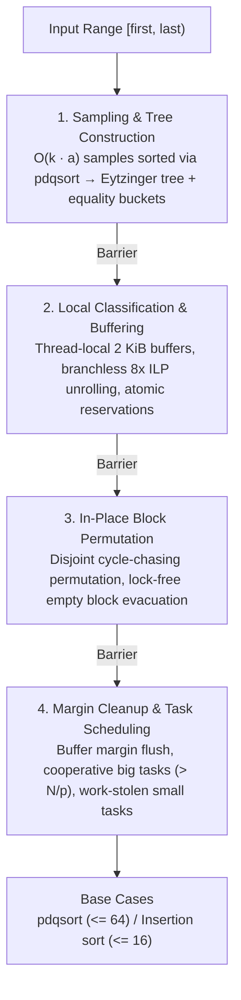

# In-Place Parallel Super Scalar Samplesort (IPS⁴o) - Internal Architecture

This directory houses the internal engine for **IPS⁴o** (`algoat::sorting::ips4o_parallel_sort`), an in-place parallel sorting algorithm engineered for modern multicore and superscalar architectures.

---

## 1. Primary References

- **Original Paper**: Michael Axtmann, Sascha Witt, Daniel Ferizovic, Peter Sanders.
  *In-Place Parallel Super Scalar Samplesort (IPS⁴o)*.
  In 25th Annual European Symposium on Algorithms (ESA 2017).
  Preprint: [arXiv:1705.02257 [cs.DS]](https://arxiv.org/abs/1705.02257).
- **Reference Implementation**: `SaschaWitt/ips4o` (BSD-2-Clause).

---

## 2. Why IPS⁴o? The Engineering Motivation

Traditional comparison sorts present trade-offs on modern hardware:
- **Quicksort / Introsort / PDQSort**: High branch misprediction rates when partitioning keys close to the pivot, and limited instruction-level parallelism (ILP).
- **Mergesort / Traditional Samplesort**: High memory bandwidth efficiency and predictable branches, but require $O(N)$ auxiliary heap memory (doubling memory requirements for large datasets).

**IPS⁴o combines the best of both paradigms:**
1. **In-Place**: Bounded auxiliary memory of $O(p \cdot k \cdot b)$ bytes (where $p$ is thread count, $k$ is bucket count, and $b$ is block size). Auxiliary space is independent of input size $N$.
2. **Branchless Classification**: Replaces conditional branches with arithmetic instructions using an Eytzinger decision tree unrolled across multiple elements.
3. **Cache & TLB Friendly**: Data moves across the bus in aligned $2\text{ KiB}$ cache blocks ($32$ cache lines) rather than random element-wise swaps.
4. **Duplicate Robust**: Explicit equality buckets guarantee $O(N)$ linear-time processing on inputs with high duplicate density without performance cliffs.

---

## 3. Four-Phase Execution Pipeline

Each recursive partitioning step executes in four distinct, barrier-synchronized phases:

### Phase 1: Sampling & Classifier Construction
A sample of $S = a \cdot k - 1$ elements is randomly drawn from the input array. The sample is sorted sequentially using `pdqsort`. From this sorted sample, $k - 1$ splitters are chosen at equidistant strides and arranged in a 1-based **Eytzinger layout** (breadth-first array order):
- Left child of node $i$ is at $2i$.
- Right child of node $i$ is at $2i + 1$.

Elements are classified using branchless arithmetic:
$$\text{node} \leftarrow 2 \cdot \text{node} + \text{comp}(\text{splitter}[\text{node}], x)$$
Unrolled across 8 elements concurrently, this eliminates branch mispredictions and keeps the CPU pipeline saturated. Additionally, $k$ equality buckets are interleaved ($2k$ total buckets) to capture keys identical to splitters; equal-bucket intervals are skipped during recursion.

### Phase 2: Local Classification & Buffering
Directly scattering elements into destination buckets would overwrite other unread elements in-place. To prevent this, each thread maintains a small local buffer of size $b = 2\text{ KiB}$ for each of the $2k$ buckets. Elements are written into these buffers until an entire $2\text{ KiB}$ block accumulates.

### Phase 3: Block Permutation
When a local buffer fills, a block in the array is reserved using atomic fetch-and-add operations on 128-bit bucket pointer words (`bucket_pointers.hpp`). The full buffer is written to the array, and the displaced block is read into a swap buffer. The thread follows this cycle of displacement until an empty slot is reached.

### Phase 4: Margin Cleanup & Subproblem Scheduling
Because bucket lengths in the array are rarely exact multiples of $b$, partially filled buffers and non-aligned margin segments at bucket boundaries are shifted into their proper positions.

Subproblems are then partitioned recursively:
- **Big Tasks** ($> N / p$): Executed cooperatively by all threads.
- **Small Tasks**: Distributed among threads via atomic task queues / work-stealing.
- **Base Case**: Subproblems falling below $n_0 = 16\text{--}64$ elements drop out of samplesort directly into `pdqsort` (or insertion sort for $N \le 16$).

---

## 4. Header Manifest

| File | Subsystem | Description |
| :--- | :--- | :--- |
| [`classifier.hpp`](classifier.hpp) | Classification | Branchless Eytzinger decision tree and equality bucket mapping. |
| [`sampling.hpp`](sampling.hpp) | Sampling | Reservoir sampling, splitter extraction, and `pdqsort` sample sorting. |
| [`buffers.hpp`](buffers.hpp) | Buffering | Thread-local classification buffers and swap buffer storage. |
| [`memory.hpp`](memory.hpp) | Memory | Cache-line alignment (`alignPointer`) and thread-safe buffer allocation. |
| [`bucket_pointers.hpp`](bucket_pointers.hpp) | Atomic State | 128-bit atomic bit-packed bucket read/write pointers. |
| [`block_permutation.hpp`](block_permutation.hpp) | Permutation | Lock-free cycle chasing and block swapping. |
| [`empty_block_movement.hpp`](empty_block_movement.hpp) | Permutation | Tracking and routing holes left during block evacuation. |
| [`cleanup_margins.hpp`](cleanup_margins.hpp) | Margin Cleanup | Buffer flushing and bucket boundary realignment. |
| [`base_case.hpp`](base_case.hpp) | Fallback | Subproblem cutoff switching to `pdqsort` and insertion sort. |
| [`thread_pool.hpp`](thread_pool.hpp) | Concurrency | Thread management, synchronization barriers, and affinity. |
| [`synchronization.hpp`](synchronization.hpp) | Concurrency | Barrier primitives and thread synchronizers. |
| [`parallel.hpp`](parallel.hpp) | Orchestration | Parallel task coordinator, big-task dispatcher, and small-task scheduler. |
| [`sequential.hpp`](sequential.hpp) | Fallback | Single-threaded sequential IPS⁴o implementation. |
| [`partitioning.hpp`](partitioning.hpp) | Utilities | Shared partitioning driver between sequential and parallel passes. |
| [`config.hpp`](config.hpp) | Configuration | Static constants (block size $b=2\text{ KiB}$, $k=256$, oversampling parameters). |
| [`ips4o_fwd.hpp`](ips4o_fwd.hpp) | Types | Forward declarations, typedefs, and concept interfaces. |
| [`utils.hpp`](utils.hpp) | Utilities | Bit manipulation, branch prediction hints (`IPS4O_ASSUME_NOT`), and math helpers. |
| [`ips4o.hpp`](ips4o.hpp) | Internal Facade | Dispatch facade between sequential and parallel sorter instances. |
